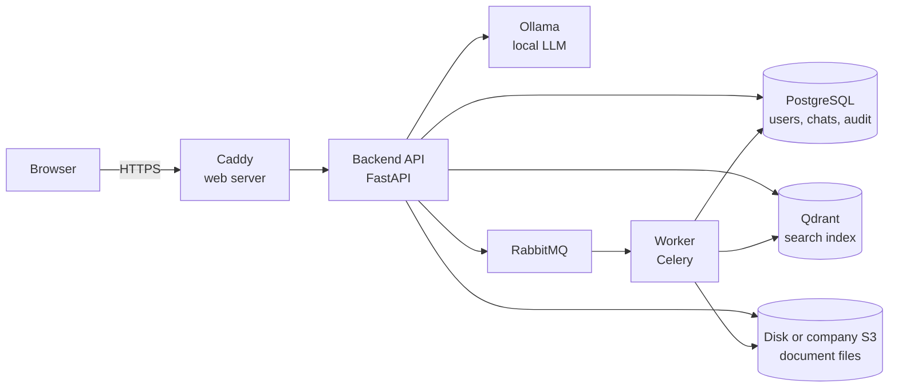

# Corpus

Corpus is a secure, confidential, self-hosted AI knowledge base for
companies. Employees ask questions in plain language and get answers taken
from the company's own documents, with the sources shown. The AI model runs
on your own server: no question or answer ever leaves your network, and
documents leave it only if you choose to keep their files, encrypted, in
cloud storage.

* **Local AI only.** The language model runs in Ollama, and search runs on
  your server. Corpus calls no cloud AI service. After installation its
  containers have no route to the internet, only narrow paths to the
  services you connect: HashiCorp Vault, the SSO provider, the S3 storage.
* **Confidential by design.** Documents, document text, chats and the error
  log are encrypted at rest with your key. Four document access levels decide
  who reads what, and the assistant answers only from documents the user may
  read.
* **Ready for audits.** Every sign-in, change and document read, including
  the documents the assistant read to answer a question, goes to an audit
  log.
* **Set up from the command line.** A guided `install` command asks a few
  questions, generates every secret and picks the models. Day-to-day changes
  go through `configure`, and production runs with one script.

## Contents

* [Features](#features)
* [For small companies and large corporations](#for-small-companies-and-large-corporations)
* [How it works](#how-it-works)
* [Security and confidentiality](#security-and-confidentiality)
* [System requirements](#system-requirements)
* [Installing on a company server](#installing-on-a-company-server)
* [Running it for development](#running-it-for-development)
* [Command-line tools](#command-line-tools)
* [Settings](#settings)
* [Customizing Corpus](#customizing-corpus)
* [Updating Corpus](#updating-corpus)
* [Documentation](#documentation)
* [Third-party software and models](#third-party-software-and-models)
* [License](#license)

## Features

### Documents

* Upload PDF, Word (`.docx`, and `.doc`, converted on upload), OpenDocument
  text, Excel (`.xlsx`), CSV, JSON, XML, Markdown and plain text, up to 50
  files at once and 32 MB each.
* Give each document an access level: standard, restricted, confidential or
  secret.
* Search and filter the library, rename a document, change its level,
  process a failed one again and delete it. The same file is not uploaded
  twice.
* Follow processing live, and get a notification when your documents are
  ready or one fails.
* Text in PDF tables, Word headings and spreadsheet rows is read with its
  structure, so answers can quote a table cell or a clause.

### AI assistant

* Ask about all documents, or choose the documents a question is about.
* Each answer streams as it is written and lists the documents it used.
  Open a source to see the exact passage the answer came from.
* Copy, stop, regenerate and rate answers. Follow-up questions ("and for
  sales?") keep the context.
* Hybrid search: meaning-based vector search plus exact keyword matching, so
  names, codes and numbers are found word for word.
* When no document answers the question, the assistant says so instead of
  making up an answer.
* Chats are saved, encrypted and searchable by their owner, and deleted
  after a retention period (90 days without activity by default).

### Users, access and sign-in

* Roles built from permissions, with no way to grant more than you hold.
* Single sign-on with OpenID Connect: Microsoft Entra ID, ADFS, Keycloak,
  Okta and others, with roles from the provider's groups. Administrators
  keep a password to get in when the provider is down.
* Disabling a user ends their sessions at once and keeps their history.
* Sessions last 12 hours at most, and repeated wrong passwords lock sign-in
  for 15 minutes.

### Administration

* **Audit log** of sign-ins, changes, document reads and reads of other
  users' chats.
* **Chat history** and **Answer ratings** for reviewers, limited to users
  whose access the reviewer also has. Delete one chat or all chats of a
  period.
* **System status** for the database, search, storage, queue, AI models and
  disk.
* **Error log** of the server and the worker, with tracebacks, encrypted.

### Languages

The interface and the assistant work in English, Spanish and French. Use one
language, or let each user pick theirs in the header.

### Operations

* Document files on the server, or in the company's own S3-compatible
  storage.
* Backup and restore with one command each. Backups are encrypted.
* Key rotation with one command.
* The encryption key can live in HashiCorp Vault instead of on the server.
* Switch the embedding model or the chunk size without losing documents.
* Light themes (Neutral, Ledger) and dark themes (Slate, Midnight), and your
  own through `custom/`.

## For small companies and large corporations

### Small companies

* **One server, one script.** Corpus runs as a Docker Compose stack on a
  single Linux server. `deploy/deploy.sh` builds, starts, updates, backs up
  and restores it. No Kubernetes and no DevOps team.
* **A guided setup instead of manual configuration.** `uv run install` asks
  for the language, the AI model and the chat limits, shows how much memory
  each choice needs, and generates every password and key.
* **Modest hardware.** An 8B model runs on a server with 16 GB of RAM and no
  GPU. Add a GPU later for faster answers.
* **One price per company.** No per-user fees: hire more people without
  paying more.
* **Safe defaults.** HTTPS, encryption, retention periods and sign-in
  limits are on from the first start.

### Large corporations

* **Single sign-on and group mapping.** Users sign in with their corporate
  account, and roles follow their directory groups at every sign-in.
* **Document classification.** Four levels, from standard to secret, are
  enforced in the document list, in search and in every answer. Reviewers
  of chats and ratings see only users whose access they also have.
* **Audit and compliance.** The audit log records who read which document,
  including through the assistant. Retention periods for chats and errors
  are configurable.
* **Key management.** Keep the encryption key in HashiCorp Vault with an
  AppRole bound to the server, rotate it on schedule, and keep data on
  LUKS-encrypted disks.
* **Your own storage.** Keep document files in the company's S3-compatible
  storage (Ceph, NetApp StorageGRID, Dell ECS, AWS S3 and others), with its
  replication, versioning and retention rules. Files arrive there already
  encrypted.
* **Network isolation.** Every service sits on an internal Docker network
  with no internet route. Only the HTTPS proxy is published. Model
  downloads, Vault, the SSO provider and the S3 storage each get a dedicated,
  narrow path.
* **Larger models.** Run 27B to 70B models on GPU servers, and set how many
  answers the model writes at the same time.
* **Customization without forking.** Add API endpoints, pages, permissions,
  background tasks, themes and translations in `custom/`, and keep receiving
  updates. See [Customizing Corpus](#customizing-corpus).

Corpus scales up, not out: one server with a bigger GPU and a larger model
serves more people. One worker processes uploaded documents in turn, and the
model writes a set number of answers at once (`LLM_PARALLEL`).

## How it works



| Part | Technology |
|---|---|
| Web interface | React and TypeScript, served by Caddy |
| API | FastAPI (Python), HTTP and WebSockets |
| Document processing | Celery worker with RabbitMQ |
| Database | PostgreSQL |
| Search index | Qdrant, with an open embedding model from Hugging Face |
| Document files | A Docker volume, or the company's S3-compatible storage |
| AI model | Ollama, `llama3.1:8b` by default |

**Uploading a document.** The backend checks that the file's content
matches its type, encrypts it and stores it on the server or in the
company's S3 storage. The worker extracts the text,
cuts it into chunks at section boundaries, turns each chunk into a vector
and indexes it for meaning and for exact words.

**Asking a question.** The backend searches the chunks of the documents the
user may read, picks the best documents, and sends their text with the
question to the local LLM. The answer streams back word by word, with its
sources and the passage each one came from. The audit log records which
documents the model read.

## Security and confidentiality

| Area | What Corpus does |
|---|---|
| Data location | Everything runs on your server, and the AI model is local. After installation no container reaches the internet: the only ways out are tunnels to the Vault, SSO provider and S3 storage you connect, each to that one address. Document files leave the server only if you keep them in S3, encrypted. |
| Encryption at rest | AES-256-GCM for document files, document text, search chunk text, chats and the error log. Backups are encrypted with the same key. |
| Key | In `backend/.env` or in HashiCorp Vault. Corpus refuses to start with a key that does not match the data. Rotation re-encrypts everything. |
| Access control | Roles and permissions, four document levels, no privilege escalation, the last administrator protected. |
| Sign-in | Passwords hashed with bcrypt, sign-in throttling, 15-minute tokens rotated on refresh, sessions of 12 hours at most, cookies with CSRF protection. Single sign-on with PKCE and full ID token checks. |
| Audit | Sign-ins and failures, changes to users, roles and documents, document reads, reads and deletions of other users' chats. |
| Web | HTTPS, HSTS, a strict Content-Security-Policy, and opened documents sandboxed. |
| Containers | The backend and the worker run as an unprivileged user with no Linux capabilities. Services sit on separate networks, and each gets only the secrets it needs. |
| Privacy | Logs never hold document text, chat content or secrets. Chats and errors are deleted after their retention periods. |

Corpus does not encrypt document names, user emails, the audit log or search
vectors. Keep the server's data on an encrypted disk. The
[deployment guide](documentations/deployment.md#encrypting-the-disk) shows
how.

## System requirements

All tiers need a 64-bit Linux server with Docker and Docker Compose v2, an
x86-64 CPU with AVX2, and an SSD. A GPU is optional but makes answers several
times faster. NVIDIA GPUs need the NVIDIA Container Toolkit.

| | Small models | Medium models | Large models |
|---|---|---|---|
| Typical company | Up to 50 users | 50 to 500 users | 500 users and more |
| LLM | `llama3.1:8b` (default) or `qwen3:8b` | `gemma3:12b` | `gemma3:27b` or `qwen3:32b`; `llama3.3:70b` for the best answers |
| Embedding model | `multilingual-e5-small` or `multilingual-e5-base` | `multilingual-e5-base` or `bge-m3` | `bge-m3` |
| **Minimum** | 4 CPU cores, 16 GB RAM, 80 GB SSD, no GPU | 8 CPU cores, 32 GB RAM, 150 GB SSD, GPU with 16 GB VRAM | 16 CPU cores, 64 GB RAM, 500 GB NVMe SSD, GPU with 48 GB VRAM |
| **Recommended** | 8 CPU cores, 32 GB RAM, 200 GB SSD, GPU with 12 GB VRAM | 16 CPU cores, 64 GB RAM, 500 GB NVMe SSD, GPU with 24 GB VRAM | 32 CPU cores, 128 GB RAM, 1 TB NVMe SSD, 80 GB VRAM or more (one or two GPUs) |
| Answers at once (`LLM_PARALLEL`) | 1–2 on CPU, 4 with a GPU | 2 at minimum, 4 recommended | 4 or more |

These are estimates for the default context of 16,384 tokens. The setup
shows the memory each model needs, and `uv run configure` shows the memory
of the answers it writes at once. Every simultaneous answer reserves its own
context memory, so more of them need more RAM or VRAM. Without a GPU an
answer takes tens of seconds.

The 27B and 70B models are not in the setup's list: choose **Other** at the
LLM step and enter the Ollama tag. Choose a model that answers well in every
language you enable.

Plan disk space for the Docker images (about 20 GB), the AI models (5 GB for
an 8B model, about 43 GB for a 70B one), and about twice the size of your
documents. Keep backups on another machine.

## Installing on a company server

You need the server described in [System requirements](#system-requirements),
`git` and [uv](https://docs.astral.sh/uv/), a host name such as
`corpus.company.local`, and internet access during installation to download
the AI models.

1. Get the code and run the guided setup. It generates the secrets and asks
   for the languages, the AI models and the chat limits.

   ```sh
   git clone REPOSITORY-URL corpus && cd corpus
   cd backend && uv run install && cd ..
   ```

2. Store the encryption key the setup shows in a safe place outside the
   server.
3. In `backend/.env`, set the address and the certificate. `TLS=internal`
   uses Caddy's own certificate; a company certificate goes in
   `deploy/certs/`.

   ```sh
   SITE_ADDRESS=corpus.company.local
   TLS=internal
   ```

4. Build and start Corpus. The first start downloads the AI models. Later
   starts need no internet.

   ```sh
   deploy/deploy.sh build
   deploy/deploy.sh up
   ```

5. Create the first administrator. The command prints the password once.

   ```sh
   deploy/deploy.sh admin ADMIN-EMAIL
   ```

6. Open `https://corpus.company.local`, sign in, change the password under
   **My account**, and check the **System status** page.

Next, create roles and users. The
[deployment guide](documentations/deployment.md) covers giving people access,
single sign-on, several languages, S3 storage, backups, disk encryption,
HashiCorp Vault and troubleshooting.

## Running it for development

You need [uv](https://docs.astral.sh/uv/), Docker with Docker Compose v2, and
Node.js 22.

1. Generate `backend/.env`:

   ```sh
   cd backend
   uv run install
   ```

2. Start Postgres, Qdrant, RabbitMQ, Ollama and a test Vault, from the
   repository root:

   ```sh
   docker compose --env-file backend/.env -f docker-compose.local.yml up -d
   ```

3. Create the tables, the default roles and an administrator:

   ```sh
   cd backend
   uv run alembic upgrade heads
   cd src
   uv run python -m seeders.run
   uv run python -m maintenance.create_admin ADMIN-EMAIL
   ```

4. Start the API and the worker in two terminals, from `backend/`:

   ```sh
   uv run uvicorn src.main:app --reload
   ```

   ```sh
   uv run celery -A worker worker --loglevel=info
   ```

5. Start the interface:

   ```sh
   cd frontend
   npm install
   npm run dev
   ```

Open `http://localhost:5173`. Run the checks before you commit:

| Part | Commands |
|---|---|
| Backend | `uv run ruff check`, `uv run ruff format --check`, `uv run ty check src`, `uv run pytest` |
| Frontend | `npx tsc -b`, `npx oxlint src`, `npx vitest run` |

The backend tests need only the local Postgres; the other services are
replaced by fakes. A test Keycloak for single sign-on starts with
`--profile sso`, and a test S3 storage with `--profile s3`. See the [backend guide](backend/README.md) and the
[frontend guide](frontend/README.md).

## Command-line tools

Run the `uv run` commands in `backend/`, and `deploy/deploy.sh` from any
folder on the server.

| Command | What it does |
|---|---|
| `uv run install` | Guided first installation: secrets, encryption key storage, document storage, languages, AI model, chat limits, embedding model, chunk size, single sign-on. Runs once: when it finishes it sets `INSTALLED=true` in `backend/.env` and from then on sends you to `configure`. Stopped halfway, it runs again and shows the steps already done. |
| `uv run configure` | Changes the settings after installation: languages, AI model, chat limits, chunk size, single sign-on, key storage, document storage. |
| `uv run configure key` | Prints the encryption key's fingerprint. `--show` prints the key itself. |
| `uv run configure key rotate` | Starts a key rotation. `configure key finish` removes the old key from Vault afterwards. |
| `uv run switch-embedding-model MODEL` | Switches the search model and rebuilds the index. Without MODEL it lists the models. |
| `deploy/deploy.sh build` | Builds the images. |
| `deploy/deploy.sh up` | Starts Corpus or applies an update, after downloading missing models. |
| `deploy/deploy.sh models` | Downloads newer versions of the models. |
| `deploy/deploy.sh admin EMAIL` | Creates an administrator. |
| `deploy/deploy.sh backup [DIR]` | Makes an encrypted backup of the database, the search index and the document files (with S3 storage, the bucket is backed up by the storage). |
| `deploy/deploy.sh restore DIR` | Replaces all data with a backup, after checking every part of it. |
| `deploy/deploy.sh rotate-key` | Re-encrypts all data with the new key. |
| `deploy/deploy.sh logs [SERVICE]` | Follows the logs. |
| `deploy/deploy.sh down` | Stops Corpus. The data is kept. |

## Settings

All settings live in `backend/.env`. The setup commands write most of them;
the file `backend/.env.example` explains each one. Settings are read when a
process starts: after a change, run `deploy/deploy.sh up`.

| Setting | Default | What it controls |
|---|---|---|
| `APP_LANGUAGE`, `APP_LANGUAGES` | `en` | Default language, and the languages users switch between |
| `LLM_MODEL` | `llama3.1:8b` | The Ollama model that writes answers |
| `LLM_NUM_CTX` | `16384` | Context size of each answer, in tokens |
| `LLM_PARALLEL` | `4` | Answers the model writes at the same time |
| `EMBEDDING_MODEL` | `multilingual-e5-base` | The search model |
| `CHUNK_SIZE`, `CHUNK_OVERLAP` | `800`, `150` | Size of the searchable pieces of a document |
| `CHAT_QUESTIONS_PER_10_MIN` | `20` | Questions per user in 10 minutes; `0` is no limit |
| `CHAT_RETENTION_DAYS` | `90` | Days a chat is kept without activity; `0` keeps chats forever |
| `ERROR_LOG_RETENTION_DAYS` | `30` | Days error log entries are kept; `0` keeps them forever |
| `KEY_STORE` | `env` | Where the encryption key lives: `env` or `vault` |
| `STORAGE` | `disk` | Where document files live: `disk` (this server) or `s3` (the company's storage, `S3_*`) |
| `OIDC_*` | empty | Single sign-on; set by the Sign-in step |
| `SITE_ADDRESS`, `TLS` | `localhost`, `internal` | Host name and certificate of the web server |

## Customizing Corpus

Add features without editing core files, so updates keep merging cleanly.
Your code lives in two folders that updates never touch:

| Folder | What you can add |
|---|---|
| `backend/src/custom/EXTENSION/` | API endpoints, permissions, database tables and migrations, background tasks, startup code that replaces any core dependency |
| `frontend/src/custom/EXTENSION/` | Pages, sidebar links, translations, themes, replacements for core pages |

Corpus finds the extensions by itself. For example, this adds an endpoint
behind its own permission:

```python
# backend/src/custom/crm/__init__.py
from fastapi import APIRouter, Depends

from api.deps import require_permission

PERMISSIONS = (("crm.report", "CRM report", "View the CRM report"),)
router = APIRouter(prefix="/crm", tags=["crm"])


@router.get("/report")
async def report(_user=Depends(require_permission("crm.report"))) -> dict:
    return {"ok": True}
```

See [Customizing Corpus](documentations/customization/en.md)
([Español](documentations/customization/es.md),
[Français](documentations/customization/fr.md)) for pages, themes,
translations, migrations and the limits of extensions.

## Updating Corpus

```sh
git pull
deploy/deploy.sh build && deploy/deploy.sh up
```

Database migrations run automatically on start. Extensions in `custom/`
stay as they are. [CHANGELOG.md](CHANGELOG.md) lists what each version
changes; the **System status** page shows the version installed.

## Documentation

* [Deploying Corpus on a company server](documentations/deployment.md):
  installation, access, single sign-on, languages, S3 storage, backups, disk
  encryption, key rotation, HashiCorp Vault, troubleshooting
* [Customizing Corpus](documentations/customization/en.md) ·
  [Español](documentations/customization/es.md) ·
  [Français](documentations/customization/fr.md)
* [Backend development](backend/README.md)
* [Frontend development](frontend/README.md)

## Third-party software and models

Corpus runs on open-source software: PostgreSQL, Qdrant, RabbitMQ, Ollama,
Caddy, LibreOffice, FastAPI, React and the libraries listed in
`backend/pyproject.toml` and `frontend/package.json`. Each keeps its own
license.

The AI models are downloaded from Ollama and Hugging Face during
installation, and each has its own license and use policy, for example the
Llama 3.1 Community License, the Gemma Terms of Use, and Apache 2.0 for
Qwen. Check the license of the models you choose.

Built with Llama: with a Llama model, the default, Corpus shows "Built with
Llama" at the bottom of the menu, as the Llama license asks.

## License

Corpus is proprietary software. Copyright (c) 2026 Nikita Andreevich
Kostenko. All rights reserved. See [LICENSE](LICENSE).

* One license covers one company: its own servers, its own employees, its
  own internal use. Each other company, including subsidiaries and clients,
  needs its own license.
* You may configure Corpus, extend it in `custom/`, and adapt it for your
  company's internal use.
* You may not distribute, resell, rent or publish the code, offer Corpus as
  a hosted service, install it for others, or sell it, changed or unchanged,
  as your own product.
* The license is perpetual and includes a year of updates. Later updates
  need a renewal.

To buy a license, renew updates or ask a question, write to
[kostneko30@gmail.com](mailto:kostneko30@gmail.com).
